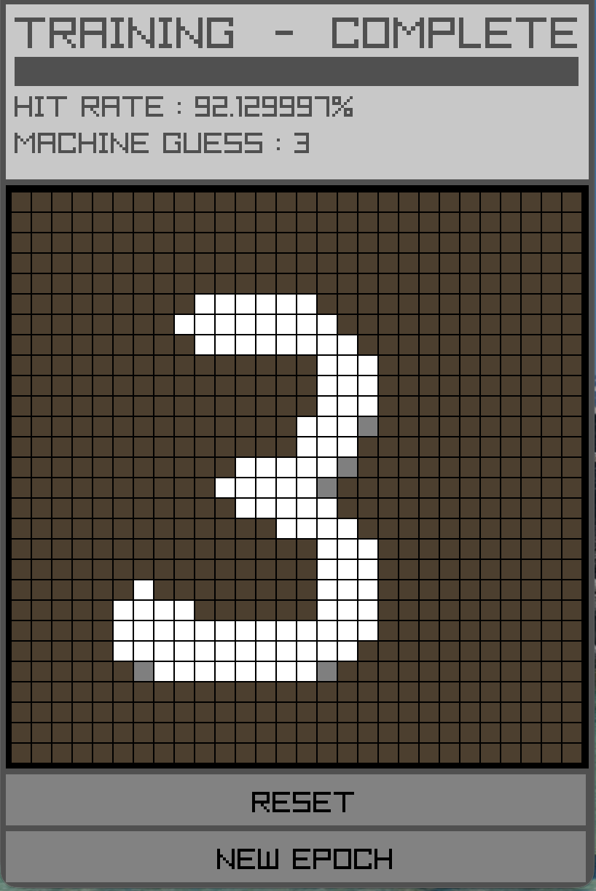

# homemade-neural-network

A feed-forward neural network implemented from scratch in C++ (no ML libraries) and trained on the [MNIST](https://en.wikipedia.org/wiki/MNIST_database) handwritten digit dataset. It can optionally train on an NVIDIA GPU using CUDA kernels. A small [raylib](https://www.raylib.com/) UI lets you draw your own digits and watch the network guess them live.

<p align="center">

</p>

## Features

- Hand-written neural network: matrix math, activation functions, forward pass, backpropagation and mini-batch SGD
- Optional CUDA backend with no cuBLAS or other libraries
- Reads the original MNIST `.gz` files directly with zlib, including validation of the file headers
- Training runs on a background thread, so the UI stays responsive and shows training progress
- Draw a digit on a 28x28 grid and get the network's guess in real time

## How it works

The network is a fully connected feed-forward network that can handle any given number of hidden layers (minimum 1 hidden layer). Each image is flattened to 784 values scaled to `[0, 1]`. Hidden layers use ReLU, the output layer uses softmax, and the prediction is the output neuron with the highest probability. The idea for the network came from 3Blue1Brown's deep learning video series.


### Batching

Instead of updating the weights after every image, the network trains on **mini-batches**:

1. Each epoch, the training set is shuffled.
2. The shuffled data is split into batches of `BATCH_SIZE` images.
3. A batch is stored as one matrix with one image per column (`784 x batch`), so a whole batch goes through each layer as a single matrix multiplication.
4. Gradients are averaged over the batch and the weights are updated once per batch.

Larger batches make better use of the hardware, especially the GPU, but give fewer weight updates per epoch. With a large batch you will usually need a higher learning rate or more epochs to reach the same accuracy.

The training settings are `#define`s at the top of `src/main.cpp`:

| Setting | Meaning |
|---|---|
| `BATCH_SIZE` | Images per mini-batch |
| `LEARNING_RATE` | Step size per weight update (gradients are already averaged over the batch, so don't scale it by the batch size) |
| `EPOCHS` | Passes over the training set per training run |
| `NETWORK_STRUCTURE` | Structure of the network with the size of its layers |

### CPU and GPU backends

- **CPU:** matrix multiplication is parallelised and vectorised with OpenMP.
- **GPU (CUDA):** the weights, activations and gradients stay in GPU memory for the whole training run. Only the input batch is uploaded each step, so there is no per-step transfer of weights. Forward pass, backpropagation, softmax and weight updates all run as CUDA kernels. After training, the weights are copied back for the UI.

The GPU only pays off with reasonably large batches. With small batches the CPU can be faster, so compare the printed epoch times for both builds.

## Requirements

Required: a C++17 compiler with OpenMP, zlib, `pkg-config` and `make`.

Optional:
- **raylib** for the drawing UI. Without it, the program trains and prints results in the terminal.
- **CUDA Toolkit (`nvcc`)** and an NVIDIA GPU for the GPU build. Linux only, since `nvcc` needs a compatible host compiler.

**macOS** (Homebrew)

```bash
brew install libomp raylib pkg-config
```

CUDA is not available on macOS, so the CPU build is used automatically.

**Debian / Ubuntu**

```bash
sudo apt install g++ make pkg-config zlib1g-dev libraylib-dev
```

If your distribution has no `libraylib-dev` package, [build raylib from source](https://github.com/raysan5/raylib). For the GPU build, install the [CUDA Toolkit](https://developer.nvidia.com/cuda-downloads) and make sure `nvcc` is on your `PATH`.

**Windows**

Use an MSYS2 MinGW64 shell:

```bash
pacman -S make mingw-w64-x86_64-gcc mingw-w64-x86_64-raylib \
          mingw-w64-x86_64-zlib mingw-w64-x86_64-pkgconf
```

The CUDA build is not supported with MinGW, so use the CPU build (`make cpu`).

## Build and run

```bash
# 1. Download the dataset (needs curl or wget)
./download_MNIST.sh MNIST/MNIST/raw

# 2. Build (auto-detects CUDA and raylib)
make

# 3. Run from the project root, so the dataset paths resolve
make run
```

If `./download_MNIST.sh` gives "permission denied", run `chmod +x download_MNIST.sh` first, or use `bash download_MNIST.sh MNIST/MNIST/raw`.

## Makefile reference

### Targets

| Command | What it does |
|---|---|
| `make` | Builds with auto-detection: uses CUDA if `nvcc` is found and raylib if it is installed. Output: `build/nn` |
| `make gpu` | Forces the CUDA build and fails with an error if `nvcc` is missing. Output: `build-gpu/nn` |
| `make cpu` | Forces the CPU-only build (no CUDA code is compiled). Output: `build-cpu/nn` |
| `make run` | Builds with auto-detection and runs `build/nn` |
| `make run-gpu` | Builds the GPU version and runs it |
| `make run-cpu` | Builds the CPU version and runs it |
| `make info` | Prints the detected platform, compiler, flags, and whether raylib and CUDA were found |
| `make clean` | Deletes `build/`, `build-gpu/` and `build-cpu/` |

`make gpu` and `make cpu` use separate build folders, so you can switch between them without a full rebuild, which makes it easy to compare CPU and GPU speed. On Windows the binary is `nn.exe`.

### Options

Options are passed on the command line and can be combined with any target above.

| Option | Example | What it does |
|---|---|---|
| `NO_UI=1` | `make NO_UI=1` | Builds without raylib (terminal-only mode) |
| `NO_CUDA=1` | `make NO_CUDA=1` | Disables CUDA in the auto-detecting build |

